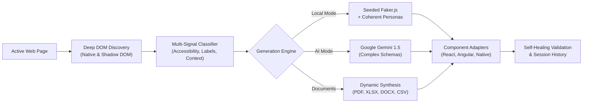
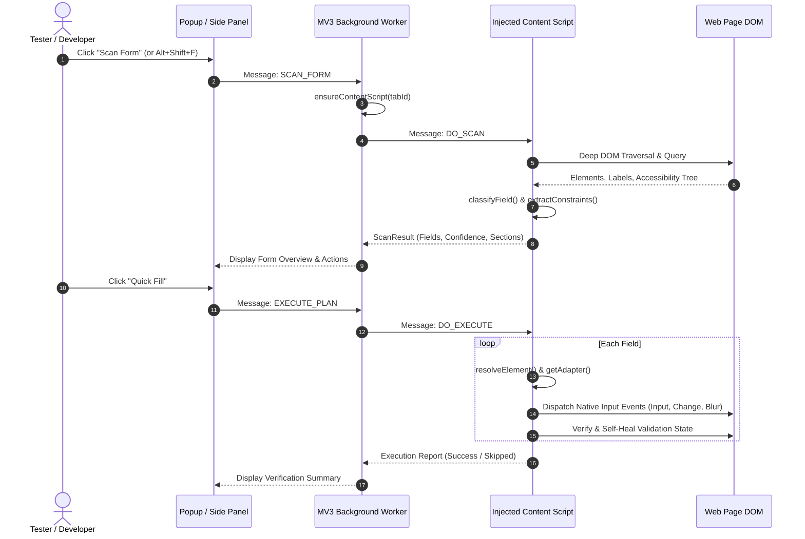

# Fill Pro

<div align="center">
  
  <h3>Understand Forms. Generate Data. Test Faster.</h3>
  <p>Production-grade, AI-powered Chrome Extension for intelligent web form testing, realistic synthetic data generation, and automated document synthesis.</p>
  
  <p>
    <a href="https://github.com/BK-KAVIYA/Fill-Pro/releases/tag/v1.0.0"></a>
    <a href="LICENSE"></a>
    
    
  </p>

  <p><strong>Developed & Maintained by:</strong> <a href="https://toolls.io">toolls.io</a> & <a href="https://github.com/BK-KAVIYA">Baladurage Kavinda</a></p>
</div>

---

## 📖 Overview

Traditional form fillers blindly populate inputs based on superficial HTML type attributes (e.g. typing random lorem words into date or phone fields). 

**Fill Pro** is an autonomous test agent that deeply analyzes the DOM tree, framework component hierarchies, accessibility landmarks, and form sections to generate **contextually coherent, mathematically valid test data and genuine test documents**.



---

## ⚡ Core Capabilities

### 1. Multi-Signal Semantic Form Scanner
- **Deep Discovery**: Scans native HTML inputs, custom contenteditable elements, multi-step radio groups, shadow DOM roots, and UI framework widgets (Angular, React, Vue, PrimeNG, Radix UI).
- **Context Extraction**: Gathers surrounding labels, section titles, fieldsets, ARIA roles, and helper descriptions to categorize fields into over 50 semantic types.
- **Compliance Intelligence**: Automatically identifies statutory/disqualification questions (e.g. criminal history, regulatory sanctions) and defaults to safe "No" answers to avoid triggering blocking compliance modal dialogs.

### 2. Context-Aware Coherent Personas
Instead of generating disjointed data, Fill Pro synthesizes unified test entities:
- **Consistent Contact Profiles**: Names, matching corporate emails, physical street addresses, and phone numbers tailored to your chosen locale (e.g., `en-US`, `en-GB`, `en-LK`, etc.).
- **Mathematically Sound Financials**: Generates balanced company statements where `Total Assets = Total Liabilities + Equity` and `Profit After Tax = Revenue - Expenses - Tax`.

### 3. Synthetic Document & File Upload Engine
Fill Pro dynamically synthesizes genuine test documents directly in-memory and drops them into browser file dropzones:
- 📄 **PDF**: Generates styled multi-page PDF documents with tables and headers using `pdf-lib`.
- 📊 **Excel (XLSX)**: Creates real multi-sheet workbooks with active formulas using `exceljs`.
- 📝 **Word (DOCX)**: Produces formatted OpenXML documents with headings and paragraphs via `docx`.
- 📑 **CSV & Plain Text**: Produces structured CSV dossiers and formatted text logs.
- 🖼️ **Images (PNG)**: Renders dynamic canvas-generated banner and identity test images.

### 4. Interactive Workspaces & Dual Theme
- **Compact Popup**: Quick-scan toolbar modal with one-click form scanning, instant fills, and quick toggles.
- **Full Side Panel**: Multi-tab testing workspace featuring an interactive field inspector, execution progress tracker, document previewer, and audit report generator.
- **Light & Dark Mode**: Persistent high-contrast theming across all extension surfaces.

---

## 🏗️ Architecture & Interaction Flow



---

## 🔒 Security, Privacy & Store Policy Compliance

Fill Pro is engineered in strict accordance with the **Google Chrome Web Store Review Policies (Manifest V3)**:

- 🛡️ **Zero Sensitive Credential Interception**: Passwords (`type="password"`), OTP codes, credit card numbers, and 2FA tokens are automatically excluded from scanning and storage.
- 🚀 **`activeTab` Permission Model**: No broad `<all_urls>` permission required. Scripts are injected strictly on-demand when the user clicks the extension action or presses `Alt + Shift + F`.
- 📦 **Zero External Server Dependency**: All data generation, IndexedDB storage, and file creation execute 100% locally on your machine.
- 🤖 **Optional AI Privacy**: When using Google Gemini for schema inference, only sanitized metadata (field labels and element types) is transmitted using your own private API key.

---

## 📁 Project Directory Structure

```text
Fill-Pro/
├── entrypoints/
│   ├── background.ts          # MV3 Service Worker & lifecycle coordinator
│   ├── content.ts             # Dynamic content script & DOM interaction layer
│   ├── popup/                 # Compact extension popup (HTML, React, Main)
│   ├── sidepanel/             # Full developer side panel interface
│   └── options/               # Comprehensive user configuration & AI settings
├── src/
│   ├── engines/
│   │   ├── discovery/         # DOM scanning & accessibility extraction
│   │   ├── semantic/          # Multi-signal heuristic classification & scoring
│   │   ├── generation/        # Seeded Faker.js engines & locale profiles
│   │   ├── interaction/       # Framework component adapters (React, Angular, Select)
│   │   ├── validation/        # Self-healing verification & error recovery
│   │   └── documents/         # On-the-fly PDF, XLSX, DOCX, & CSV synthesis
│   ├── ai/                    # Gemini API integration & schema reasoning
│   ├── database/              # Dexie.js / IndexedDB persistent local storage
│   ├── constants/             # Semantic types, default rules, & locale sets
│   ├── stores/                # Zustand state management
│   ├── styles/                # Tailwind CSS & global light/dark theme rules
│   └── types/                 # Strict TypeScript interface contracts
├── scripts/
│   └── sanitize-utf8.py       # Chromium UTF-8 bytecode sanitizer & manifest tuner
├── tests/
│   └── unit/                  # Vitest suite (Classifier, Generators, Documents)
└── public/
    └── icons/                 # Official 16px, 32px, 48px, 128px PNG assets
```

---

## 💻 Development & Build Setup

### Prerequisites
- Node.js (v18 or higher)
- `pnpm` (v9 or higher)

### Setup Instructions
```bash
# 1. Clone the repository
git clone https://github.com/BK-KAVIYA/Fill-Pro.git
cd Fill-Pro

# 2. Install dependencies
pnpm install

# 3. Start local development server (with HMR)
pnpm dev

# 4. Run test suite
pnpm test

# 5. Build production extension package
pnpm build
```

### Loading into Google Chrome
1. Navigate to `chrome://extensions/`.
2. Toggle on **Developer mode** in the upper-right corner.
3. Click **Load unpacked**.
4. Select the `dist/` directory inside this project.
5. Open any form or the test fixtures in `test-apps/` and press `Alt + Shift + F`.

---

## 🤝 Contributing

Contributions, issues, and feature requests are welcome!
Feel free to check the [issues page](https://github.com/BK-KAVIYA/Fill-Pro/issues).

---

## 📄 License

Distributed under the MIT License. See `LICENSE` for more information.
